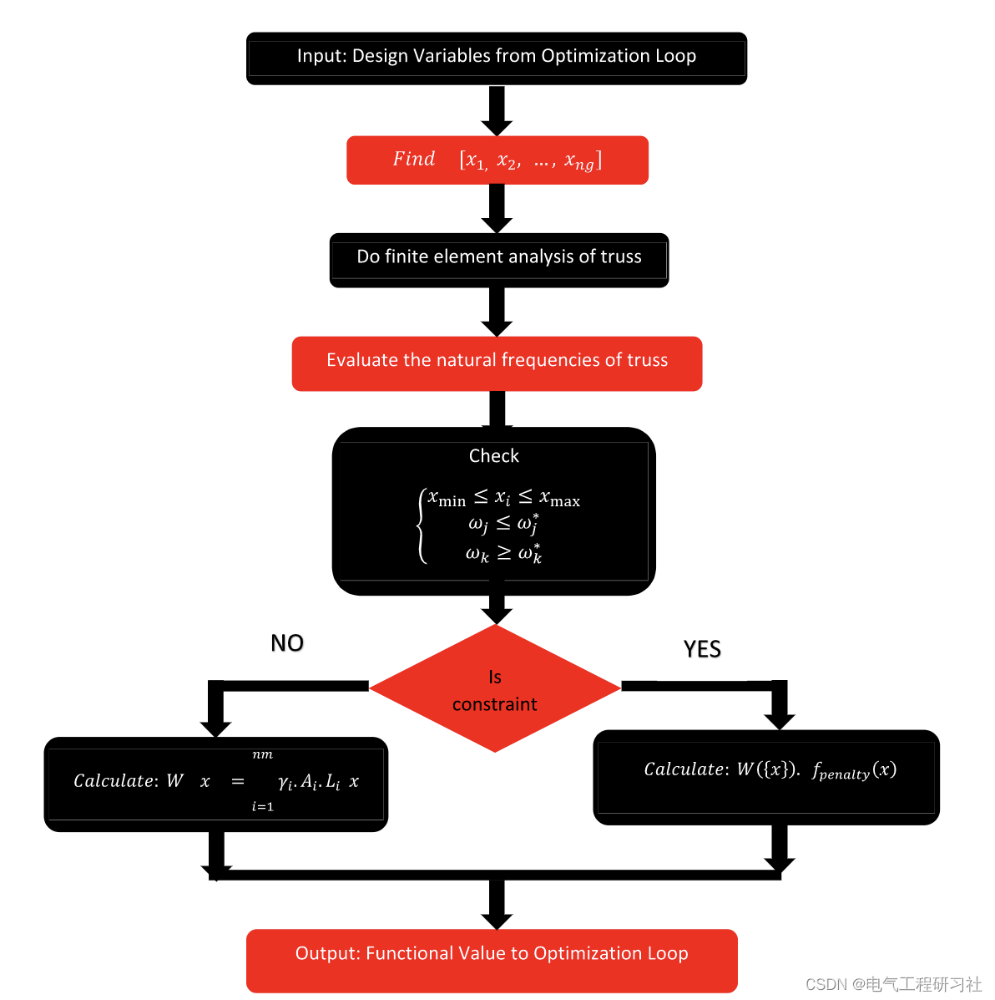
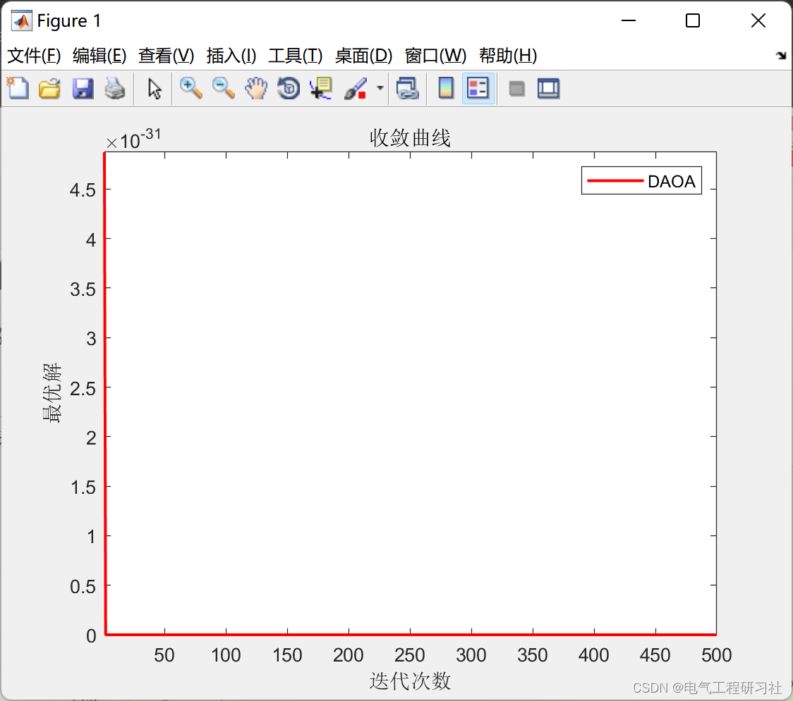
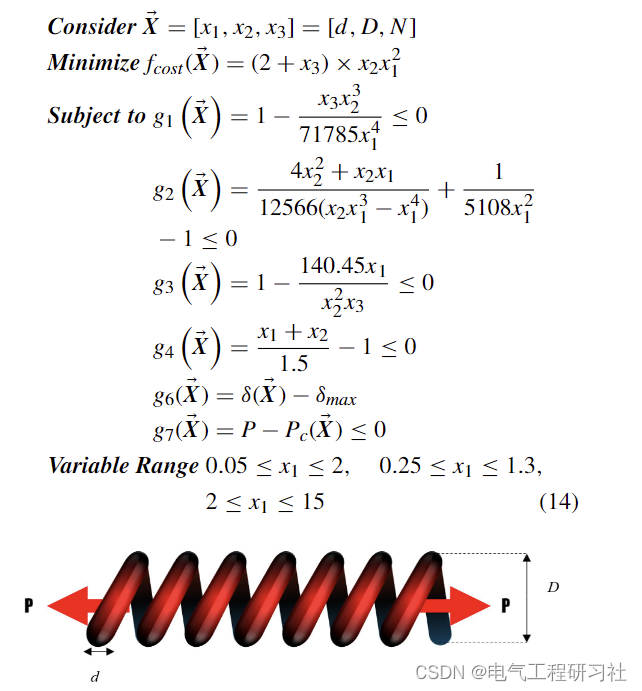
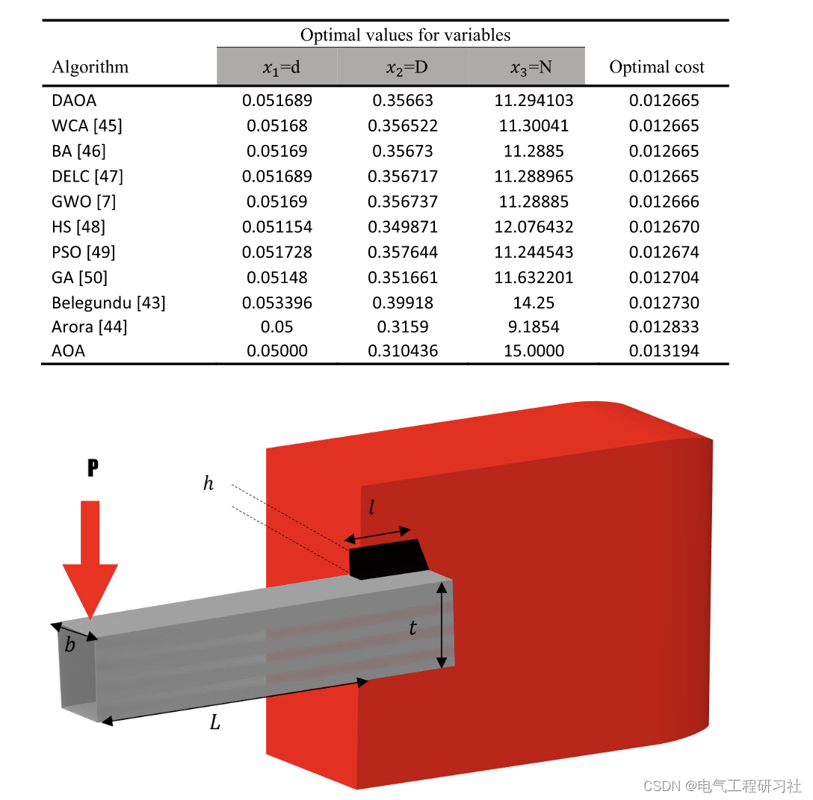
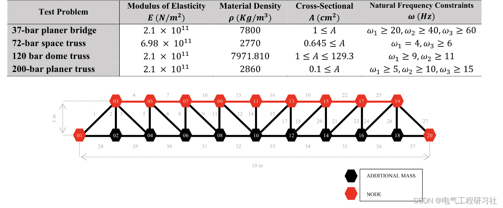
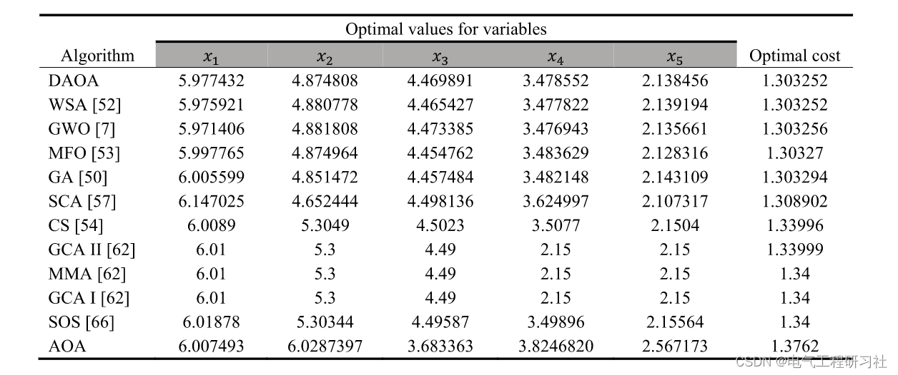
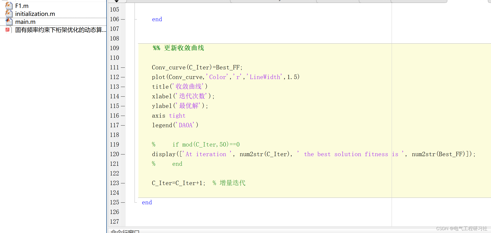

# Dynamic Arithmetic Optimization Algorithm for Truss Optimization under Fundamental Frequency Constraints (Matlab Code Implementation)

​  
1 Abstract Metaheuristic algorithms have been successfully applied to solve any type of optimization problems in the field of structural engineering. The recently proposed Arithmetic Optimization Algorithm (AOA) is used to solve mathematical problems. AOA is a metaheuristic algorithm that uses the distribution behavior of major arithmetic operators, such as multiplication, division, subtraction, and addition in mathematics. In this paper, the dynamic version of the Arithmetic Optimization Algorithm (DAOA) is proposed. During the optimization process, new candidate solutions will change, exploring and exploiting dynamically according to the specification in each iteration. The most notable attribute of DAOA is that it does not require any effort to initially fine-tune against the current metaheuristic parameters. Additionally, new accelerator functions are added to achieve better search phases. To evaluate the performance of AOA and its dynamic version, several truss structures were minimized under frequency constraints. The efficiency of these algorithms was obtained by testing on five classical engineering problems and optimizing different truss structures under various loading conditions and restrictions.
Keywords: Dynamic Arithmetic Optimization Algorithm; DAOA, Frequency Constraints, Optimal Design, Truss Structure, Optimization
2. Optimization of Truss Structure
Editor
Detailed mathematical models are available in Part 4.3 Examples and operational results
Editor
Editor
Editor
Editor: 4 Matlab Code and Article Details Reading. This article only showcases a portion of the code, all codes can be found in:
Editor
Over the past few decades, various metaheuristic optimization techniques have been developed to address various engineering problems. These algorithms discover search regions using pseudo-random methods that adhere to some incentive principles and do not require gradients. Recently, metaheuristic algorithms have gained popularity across various fields due to their effectiveness compared to deterministic algorithms, requiring less computational power, and achieving results in a shorter timeframe. To achieve optimal results, simple principles need to be followed and ported across multiple domains. By incorporating random elements into metaheuristic algorithms, local optima can be avoided, allowing the algorithm to explore the best solution within the search region, thereby preventing it from becoming locally optimal. Specific gradient descent algorithms are more useful when utilizing gradient information than random algorithms directly or indirectly applied to direct and direct problems. In fact, the convergence speed of metaheuristic algorithms is likely to be significantly slower than that of gradient descent algorithms, which could be considered a disadvantage [1]. Metaheuristic algorithms used to find better solutions for optimization problems often draw inspiration from human, natural, physical, and artistic phenomena. In practical scenarios, many problem spaces are infinite or typically infinite. It may not be possible to find the optimal solution by traversing the current solution space. Metaheuristic algorithms detect nearly optimal solutions to the problem by randomly identifying important solution areas within one method, thus identifying or creating better solutions to the optimization problem at minimal environmental or computational costs.
5. Conclusion
​  

## Images

<!-- PAYMENT_BLOCK -->

## Get this dataset

- Payment link (Stripe): [Buy now](https://buy.stripe.com/3cs8yP7sY87d0vu9AB)
- Payment QR code: 

<!-- /PAYMENT_BLOCK -->
